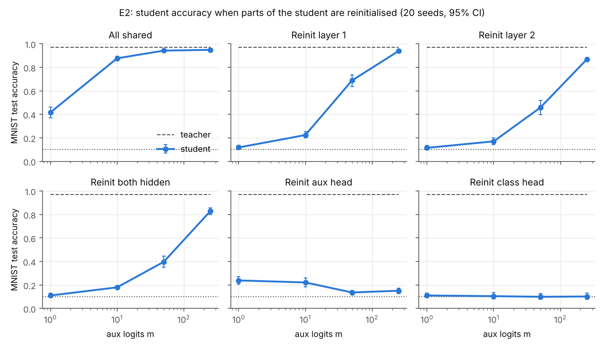
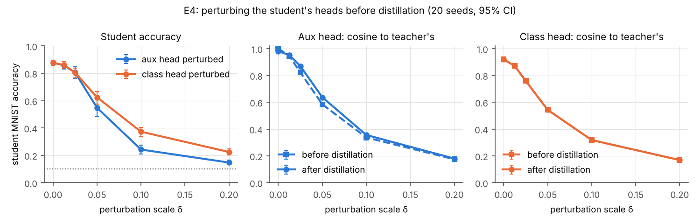
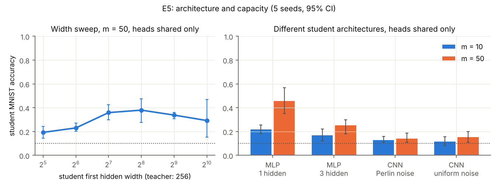
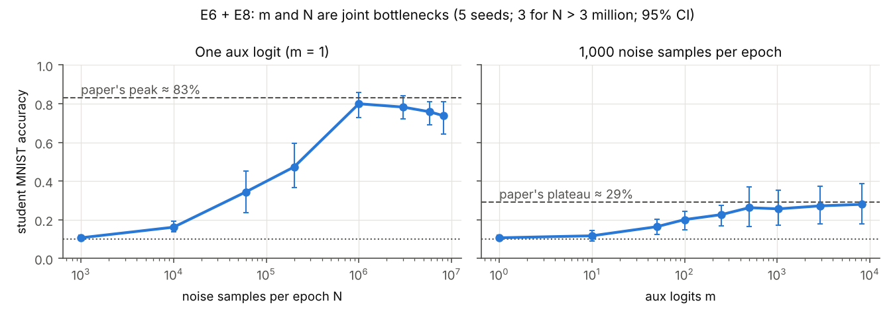
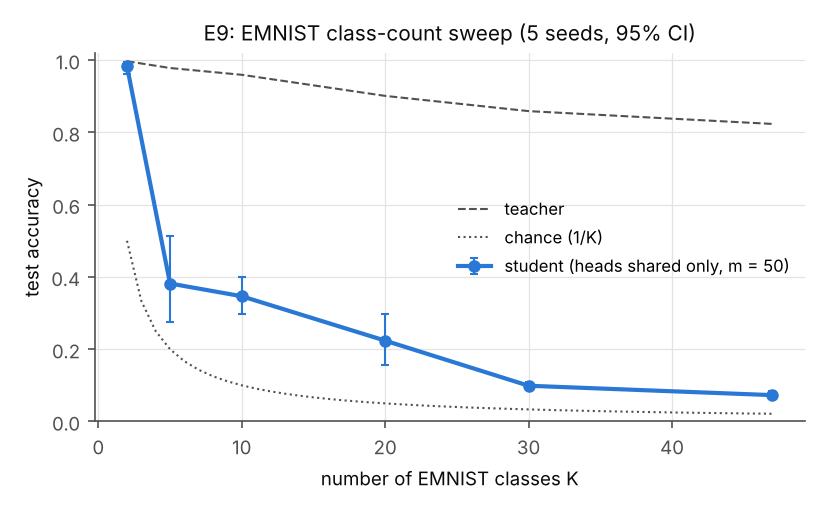
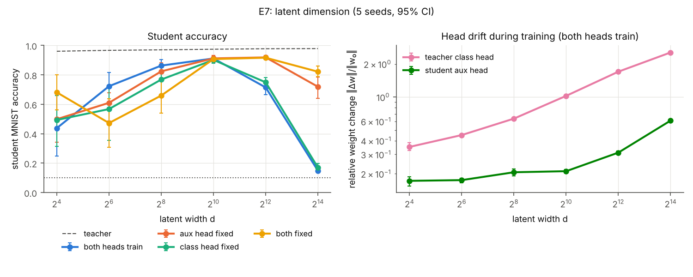
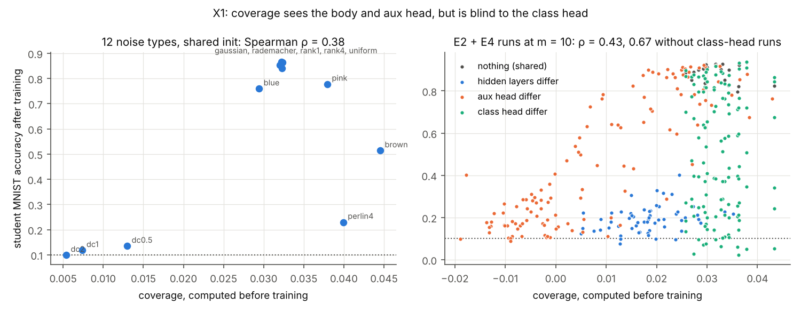
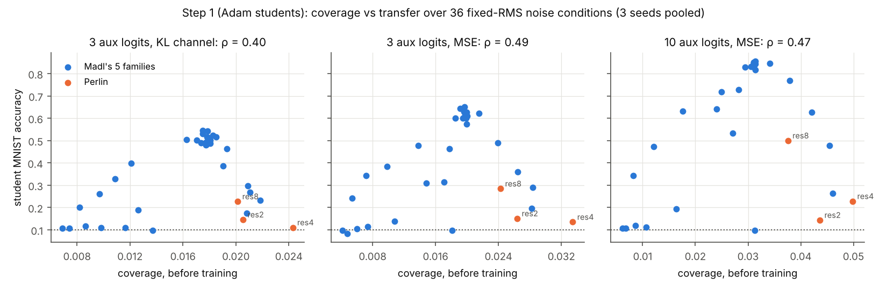
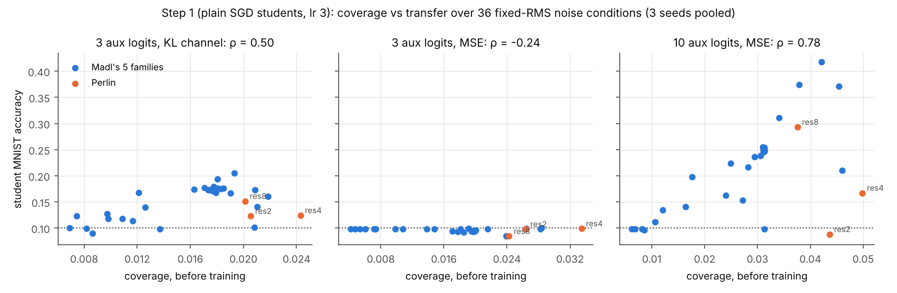
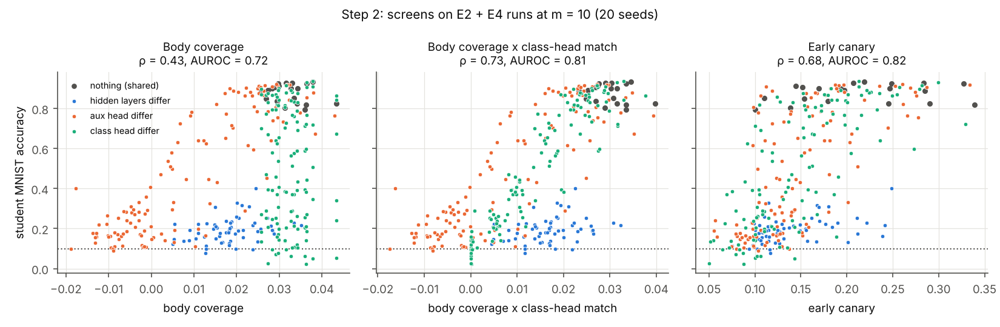

# subliminal-noise

A from-scratch, CPU-only replication of

> **Learning Through Noise: Why Subliminal Learning Works and When It Fails**
> Brockers, Ventzke, Neuhaus, Hidalgo-Ogalde, Priesemann. arXiv [2605.23645](https://arxiv.org/abs/2605.23645), May 2026.

plus one extension: the pre-training **coverage screen** from

> **Channel Location Constrains the Auditability of Subliminal Learning**
> Madl. arXiv [2606.22019](https://arxiv.org/abs/2606.22019), June 2026.

Subliminal learning is when a student model inherits a teacher's traits from
distillation data that never mention them. The paper studies it in a controlled
MNIST setting: the teacher learns digits through a *class head*, the student only
ever imitates the teacher's *auxiliary* logits on random noise, and yet the student
ends up classifying digits through its untouched class head. The paper's claim is
that this is governed by **compatible output heads**, not by a shared
initialisation of the hidden layers.

## Results at a glance

**The paper's central claim reproduces.** Matching output heads, not a shared
initialisation of the hidden layers, is what lets a student learn MNIST from noise.
9 of the paper's 10 claims we tested reproduce fully; the CNN student transfers
only weakly. Madl's coverage screen did not reproduce, and turned out to be blind
to the class head; a class-head-aware version fixes most of that (see *Follow-ups*).
1,450 trained student runs in all, on 4 CPU cores.



*Reinitialising the student's hidden layers only delays transfer: accuracy comes
back as m grows. A reinitialised aux or class head keeps the student near chance
at every m (claims 2-4).*

| # | Claim (paper) | Our result | Verdict |
| --- | --- | --- | --- |
| 1 | Students trained only on noise learn MNIST (E1) | Student 87.7% [85.7, 89.7], teacher 97.1%, chance 10% | Reproduced |
| 2 | Shared hidden layers are not needed (E2, Fig. 2b-d) | Both hidden layers reinitialised: 11% at m = 1, rising to 82.9% at m = 250 | Reproduced |
| 3 | A reinitialised class head kills transfer (Fig. 2f) | 10.0-11.1% at every m | Reproduced |
| 4 | A reinitialised aux head strongly suppresses it (Fig. 2e) | 15.1% vs 95.0% (all shared) at m = 250; falls as m grows | Reproduced |
| 5 | Best case matches the teacher (Tables 3-4: 96.82% vs 96.86%) | Student 96.7% vs teacher 96.8% (20 seeds) | Reproduced |
| 6 | Aux-head damage is partly repaired, class-head damage is not (Fig. 5) | Accuracy falls with δ for both; aux-head cosine to teacher rises during training (0.82 to 0.87 at δ = 0.025); class head unchanged | Reproduced |
| 7 | Other architectures transfer; width is non-monotone (Fig. 3a-b) | MLP with 1 or 3 hidden layers transfers (46%, 25% at m = 50); width peaks at 256; CNN 20.8% [14.1, 27.5] at m = 50 with the authors' Perlin noise (E8), 46.2% at m = 250 (E5b) | Partly |
| 8 | m = 1 peaks near 83% then declines; N = 1,000 plateaus near 29% (Fig. 4b-c) | Peak 80.0% at N = 10^6, falling to 73.8% at 8.2 x 10^6 (paired -4.4 points); 26-28% from m = 500 to 8,192 (E6 + E8) | Reproduced |
| 9 | Large latent width breaks transfer via aux-head drift (Fig. 6, 13) | Free heads: 91.1% at d = 1,024, 14.9% at d = 16,384; aux head fixed 71.9%, both fixed 82.2%, class head fixed 17.0% | Reproduced |
| 10 | More classes need a stronger signal (EMNIST, Fig. 3c) | From 2 to 47 classes the teacher drops 99.7% to 82.3% but the student 98.3% to 7.3% (E9) | Reproduced |
| 11 | Extension: coverage predicts transfer, Spearman ρ ≈ 0.95 (Madl, Sec. 3) | ρ = 0.38 across 12 noise types, 0.40-0.49 in a Madl-like sweep (X2); blind to the class head | Not reproduced |

Brackets are 95% bootstrap CIs over seeds. Full tables: [`results/summary.md`](results/summary.md).

### Figures



*Noise added to either head before distillation lowers accuracy. Training pulls a
perturbed aux head back toward the teacher's; the class head never changes
(claim 6).*



*Students with one fewer or one more hidden layer still transfer, and accuracy
peaks near the teacher's width of 256. A CNN student barely transfers at m <= 50
with our Perlin noise; the authors' version lifts it to 20.8% (claim 7).*



*With one aux logit, more noise lifts accuracy to 80%, then it declines. With
1,000 noise samples per epoch, more aux logits level off near 28% (claim 8).*



*As the number of classes grows, the student falls much faster than the teacher
(claim 10).*



*Transfer collapses at large latent width as the heads drift; freezing the aux
head prevents most of the collapse (claim 9).*

### What the extension found

Coverage is the cosine between the student's first distillation update and the
teacher's training displacement, computed before the student trains. It is
computed on the network body, so it can only see problems on the input side of
the latent:

* It **tracks the aux head**. Perturbing the student's aux head lowers coverage
  (0.032 to -0.007) and accuracy together (Spearman 0.82).
* It is **structurally blind to the class head**. A reinitialised or perturbed
  class head leaves coverage exactly unchanged while accuracy drops to chance.
  That is the paper's second condition (class-head compatibility), and a
  body-only screen cannot see it.
* Across noise types it fails on smooth noise: Perlin and brown (1/f²) noise
  have the highest coverage but low transfer (23%, 51%).

We expected the screen to go blind when the hidden layers are reinitialised.
It did not (ρ ≈ 0.9 across conditions at m >= 50); the blind spot is the readout.



*Left: across noise types, smooth noise (Perlin, brown) has high coverage but low
transfer. Right: runs with a mismatched class head (green) spread from chance to
90% at the same coverage (claim 11).*

## Follow-ups

Three follow-up steps after the main replication. Tables:
[`results/screens_summary.md`](results/screens_summary.md) and [`results/summary.md`](results/summary.md).

### 1. Does coverage work in a setup closer to Madl's? (X2, 324 runs)

**No: Spearman ρ is 0.40-0.49, not 0.95, in every setting we tried.** We swept 36
noise conditions at a fixed input scale in his five families (DC level, rank,
spectral slope, distribution shape, mixtures) plus Perlin, with 3 aux logits and a
soft-label KL channel (closest to his appendix), 3 aux logits with MSE, and our 10
aux logits with MSE.

| Setting | ρ over his 5 families (33 conditions) | Within DC / mixture families | Within spectral family |
| --- | --- | --- | --- |
| 3 aux logits, KL | 0.40 | 0.86 / 1.00 | -0.88 |
| 3 aux logits, MSE | 0.49 | 0.96 / 1.00 | -0.42 |
| 10 aux logits, MSE | 0.47 | 0.96 / 1.00 | -0.43 |

Coverage tracks DC contamination (the "causal dial" of his Section 3), but smoother
noise raises coverage while lowering transfer, so across families the relationship
is an inverted U.



**Rerun with plain SGD students (X3, 324 runs).** The optimizer explains part of the
gap. Coverage measures the raw gradient direction; plain SGD follows it, Adam (the
replicated paper's optimizer, used above) rescales each weight's step.

| Setting | ρ with Adam | ρ with plain SGD (lr 3) | SGD accuracy range |
| --- | --- | --- | --- |
| 10 aux logits, MSE | 0.47 | 0.78 | 9-42% |
| 3 aux logits, KL | 0.40 | 0.50 | 9-21% |
| 3 aux logits, MSE | 0.49 | -0.24 | 8-10% (no transfer, nothing to rank) |

In the 10-logit setting the smooth-noise inversion disappears (spectral family -0.43
to +0.48). It still stops short of 0.95, and SGD students inherit far less (at most
42%, against 85% with Adam). One learning rate (3, the largest stable one in a
calibration on uniform noise) was used for every condition.



### 2. A screen that can see the readout

We compared candidate screens over existing runs (scored after the fact with
[`scripts/screen.py`](scripts/screen.py); all 760 rebuilt teachers matched the
originals bit for bit). Spearman ρ / AUROC for transfer above 20%:

| Screen | Head + body mismatches (340 runs) | All E2 (480) | Noise types (X2, 324) |
| --- | --- | --- | --- |
| Body coverage (Madl) | 0.43 / 0.72 | 0.48 / 0.74 | 0.43 / 0.70 |
| **Body coverage x class-head cosine** (before training) | **0.73 / 0.81** | **0.79 / 0.89** | 0.43 / 0.70 |
| **Early canary**: agreement with the teacher after 5% of training | 0.68 / 0.82 | 0.78 / 0.88 | **0.58 / 0.79** |
| One-step readout coverage (first-order change in class logits) | 0.08 / 0.55 | 0.22 / 0.59 | 0.38 / 0.65 |

Adding a class-head check to coverage repairs the blind spot; the early canary is
the best all-rounder but needs a short slice of the real distillation run. A
first-order screen in output space does not work: one step barely moves the
student's predictions.



### 3. Closing the replication gaps (E8, E9)

* **m and N:** pushing to the authors' largest settings resolves both shapes: the
  m = 1 decline after the peak, and the plateau near 28% (claim 8 is now reproduced).
* **CNN:** the authors scale each Perlin image to a peak of 1; ours had about half
  that amplitude. Their noise lifts the CNN student from 14.2% to 20.8% at m = 50,
  still well below the MLP students, so claim 7 stays partial.
* **EMNIST:** reproduced (claim 10).
* **The authors' code** ([Priesemann-Group/subliminal_learning](https://github.com/Priesemann-Group/subliminal_learning))
  matches our setup on everything else we checked. One slip: its two fixed-head
  scripts for Fig. 6/13 appear swapped. `d_sweep_fixed_aux_head.sh` passes
  `true,true,false,true`, which its positional parser maps to
  `[fc1, fc2, class_head, aux_head]`, so it freezes the class head. Our runs freeze
  heads by name and agree with the paper's text.

### 4-5. Write-up and language models

* [`followups/post_draft.md`](followups/post_draft.md): a draft post for sharing (not posted).
* [`followups/llm_scope.md`](followups/llm_scope.md): a scoped plan for testing head
  compatibility in language models; it needs a GPU and Hugging Face access.

## Deviations from the paper

* **Seeds.** 20 seeds for E1-E4, as in the paper; 5 for E5-E7, E9 and X1; 3 for X2 and for
  the longest E8 runs (N above 3 million).
* **Choices the paper leaves open.** m grid {1, 10, 50, 250} for E2; δ grid
  {0.0125, ..., 0.2} (default weight scale is about 0.06); student widths 32-1024;
  "latent dimension" is the width of the last hidden layer (the first stays 256);
  E6 keeps 1,000 noise images per step and varies steps per epoch.
* **Perlin noise** in E5 is our own implementation (resolution = grid cells per 28 px),
  with std 0.31. The authors' code scales each image to a peak of 1 (std 0.37);
  E8 reruns the CNN with that version.
* **Not run:** the full (m, N) heatmap (Fig. 4a; we ran its two slices) and the
  Appendix A theory checks (eq. 28, eq. 58). EMNIST (Fig. 3c) was added in E9 once
  its download host was allowed.
* **X1** uses our own versions of Madl's five noise families (DC level, spectral
  slope, distribution shape, low rank, Perlin), not his 54 conditions, and the MSE
  channel (his appendix uses soft cross-entropy).
* **E5b** is an off-paper diagnostic for the weak CNN result: at m = 250 the CNN
  student reaches 46.2% (an MLP student with independent hidden layers: 81.6%);
  rescaling Perlin noise to uniform's std lifts m = 50 from 14% to 22.6%.

## Setup

Everything follows the paper's Appendix C (Table 1) unless listed under *Deviations*.

| | |
| --- | --- |
| Models | MLP 784-256-256 with a class head (10) and an aux head (m, default 10); 271,892 parameters |
| Teacher | Adam 1e-3, 5 epochs, batch 1024, cross-entropy on the class head only |
| Student | Adam 1e-3, 5 epochs x 60 steps of 1,000 noise images (N = 60,000 per epoch), MSE on the aux head only |
| Noise | U(-1, 1) per pixel; Perlin noise (resolution 8) for CNN students |
| Data | MNIST, normalised with mean 0.1307, std 0.3081 |
| Uncertainty | mean over seeds, 95% bootstrap CI over seeds |
| Compute | 4 CPU cores, no GPU; about 7 s per teacher or student run on one core |

Parameter counts match the paper's Tables 1 and 2 exactly (checked in `tests/`).

## Repository layout

```
src/sublim/
  models.py     split-head MLP and CNN (Tables 1-2)
  init.py       layerwise shared / independent init, head perturbation, freezing
  noise.py      uniform, Perlin, X1 and fixed-RMS X2 noise families
  train.py      teacher training, student aux distillation (MSE or KL; Adam or SGD), evaluation
  coverage.py   screens: Madl's coverage, readout coverage, early-agreement canary
  data.py       MNIST and EMNIST (balanced, first K classes) as in-memory tensors
  runner.py     one job = one teacher + all student conditions distilled from it
experiments/    one config per experiment (E1-E9, X1-X3)
scripts/run.py              parallel, resumable sweep launcher -> results/runs.jsonl
scripts/screen.py           screens for existing runs, no retraining -> results/screens.jsonl
scripts/analyze.py          tables (results/summary.md) and figures (results/figures/)
scripts/analyze_screens.py  follow-up steps 1-2 (results/screens_summary.md)
followups/      draft post and the language-model scope
tests/          invariants: shared init identical, heads untouched where they must be, ...
```

## Reproduce

```bash
pip install torch torchvision scipy pandas matplotlib pytest
python -m pytest -q tests
python scripts/run.py e1_baseline e2_init_ablation e3_best_case e4_perturbation --workers 4
python scripts/run.py e5_architecture e6_m_and_n e7_latent_dim x1_noise_sweep --workers 4
python scripts/run.py e5b_cnn_diagnostic x2_madl_sweep x3_sgd_sweep e8_gaps e9_emnist --workers 4
python scripts/screen.py e2_init_ablation e4_perturbation x1_noise_sweep --workers 4
python scripts/analyze.py
python scripts/analyze_screens.py
```

MNIST downloads to `data/` on first use (override with `SUBLIM_DATA`).
